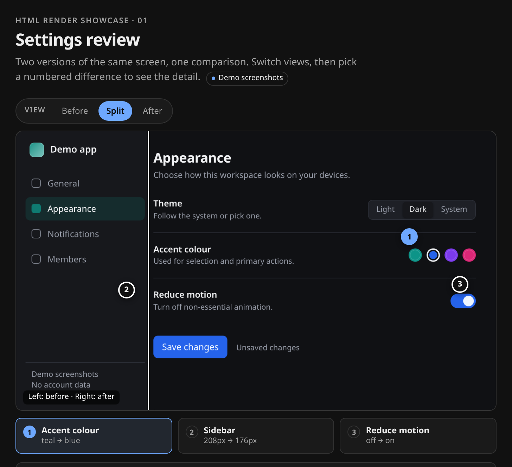

# HTML Render

**Turn an answer into something you can see.**

Ask Paseo for a comparison, a flow, a screenshot review or a set of numbers. Instead of a wall of Markdown, the agent can publish a self-contained visual card above its reply.



<sub>A real capture of the [image-inspection demo](examples/showcase/image-inspection.html). The capture is a standalone demo page, not a mocked Paseo window; on web/desktop the same page runs as a live card in the timeline.</sub>

New agents get two injected MCP tools: `html_preview` checks the page as a PNG, and `html_render` publishes the card and keeps a link to the full interactive HTML file.

## Try asking

- “Compare these two screenshots of the settings screen. Show me what changed and let me inspect each difference.”
- “Show me how a visual gets from my request into the timeline, including what my phone sees.”
- “Replay this deploy failure as a timeline I can step through, and show what happened at each point.”

[See the gallery](docs/showcase.md) for all three prompts, their actual captures, and copyable source pages.

## Install

The tested package version is **2.2.0**. Check the registry for that exact version first:

```sh
npm view paseo-html-render@2.2.0 version dist.integrity
```

If it is available, install it:

```sh
paseo plugin install npm:paseo-html-render@2.2.0
paseo plugin ls
```

Otherwise, use the tested checkout:

```sh
git clone https://github.com/lued/paseo-html-render.git
cd paseo-html-render
npm ci --ignore-scripts
paseo plugin install .
paseo plugin ls
```

Create a new agent after installing or upgrading so it receives the tools. Requires Paseo `>=0.12.0 <0.14.0` (tested with 0.12.0 and 0.13.0-beta.2), Node 22.18 or newer on the daemon host, and a sandbox-capable Chromium. Chromium is discovered from `PASEO_HTML_RENDER_CHROMIUM`, a Playwright cache, an installed `shared-browser` runtime, system Chromium, or an installed Chromium-family app. No browser is downloaded or installed.

## What it does

1. **Ask naturally.** A comparison, an explanation, a review of an image you already have, or a chart of tool output.
2. **The agent composes one self-contained page** and can check it with `html_preview`. That preview is a PNG with page scripts disabled, so clipping and contrast show up before publishing.
3. **`html_render` publishes it above the reply.** On web and desktop it is a live sandboxed frame; phones get a static PNG or a structured native report. The reply keeps an `Open interactive report` link to the full HTML file.

Cards are a choice, not a default: one per turn when attribution is available, otherwise the agent replies in text. Artifacts are owner-only files on the daemon host, and every plugin read is checked against the requesting agent's workspace.

Live pages can use local controls, CSS transitions and inline SVG. Screenshots and native reports never execute page JavaScript. Remote scripts, styles, fonts and images are blocked; workspace raster images are inlined up to 2 MiB each. Local SVG files are refused, while inline SVG works. More detail: [compatibility and limits](docs/compatibility.md) and the [interaction guide](docs/interactivity.md).

## Limits

- The live web/desktop frame cannot control Paseo agents, workspaces or files. Its controls are local; it can ask the host to open an `http(s)` link or a data-URI image.
- A live page can still navigate itself; CSP and click interception do not fully contain `location.assign` or a meta refresh.
- The turn guard compares exact prepared inputs and is not a permanent duplicate database: cosmetic changes count as new, a daemon restart clears state, and missing attribution or unknown turn lifecycle degrades with a warning. A late file-path failure after a durable save can return an error while still using the turn slot.
- Agents created before install do not get the tools; start a new agent. After an upgrade, a running adapter may report itself stale, so reconnect the agent.

## Develop

```sh
npm ci --ignore-scripts
npm run typecheck && npm test
npm run verify:e2e
```

MIT. Display rules, exact security boundaries and verification evidence are in [OVERVIEW.md](OVERVIEW.md), [docs/release.md](docs/release.md), and [the public verification notes](https://github.com/lued/paseo-html-render/blob/main/docs/verification.md). Feedback is welcome in the [issue tracker](https://github.com/lued/paseo-html-render/issues); see [CONTRIBUTING.md](CONTRIBUTING.md) and report vulnerabilities through [SECURITY.md](SECURITY.md).
