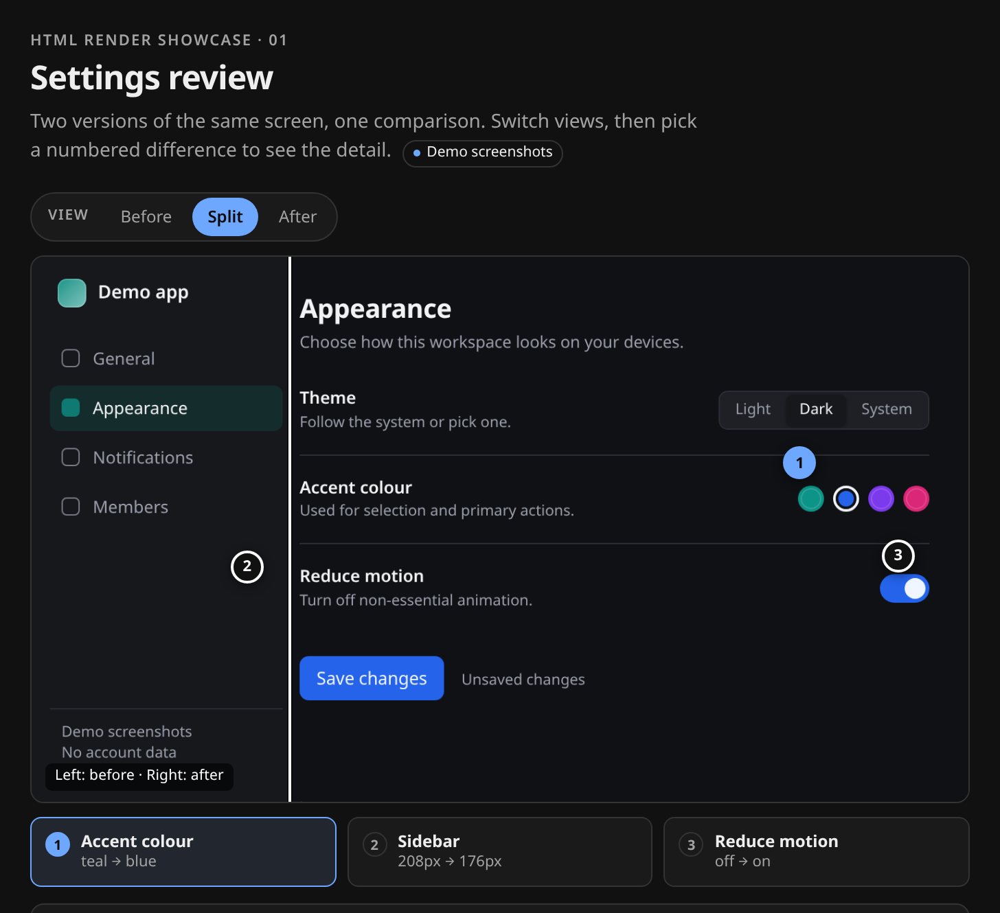

# HTML Render

**Turn an answer into something you can see.**

Ask Paseo for a comparison, a flow, a screenshot review or a set of numbers. Instead of a wall of Markdown, the agent can publish a self-contained visual card above its reply.



<sub>A real capture of the [image-inspection demo](examples/showcase/image-inspection.html): a standalone demo page, not a mocked Paseo window. On web/desktop it runs as a live card.</sub>

Each interactive agent session gets two MCP tools: `html_preview` checks the page as a PNG, and `html_render` publishes the card with a link to the full HTML file.

## Try asking

- “Compare these two screenshots of the settings screen. Show me what changed and let me inspect each difference.”
- “Show me how a visual gets from my request into the timeline, including what my phone sees.”
- “Replay this deploy failure as a timeline I can step through, and show what happened at each point.”

[See the gallery](docs/showcase.md) for all three prompts, their actual captures, and copyable source pages.

## Install

**3.0.0 is an unreleased candidate**, not a published npm release. To test it, install the checkout:

```sh
git clone https://github.com/lued/paseo-html-render.git
cd paseo-html-render
npm ci --ignore-scripts
paseo plugin install .
paseo plugin ls
```

Existing agents get the tools on their next prompt (Pi defaults: restart the daemon once, see [compatibility](docs/compatibility.md)). Requires a Paseo daemon `>=0.14.0-beta.1` (tested on 0.14.0-beta.1 and 0.14.0, plus 0.15.0/0.15.2), a Paseo app 0.13.2 or newer, Node 22.18 or newer on the daemon host, and a sandbox-capable Chromium (via `PASEO_HTML_RENDER_CHROMIUM`, a Playwright cache, `shared-browser`, or an installed Chromium-family browser). The manifest has no upper cap, so newer apps load it. No browser is downloaded or installed.

## What it does

1. **Ask naturally.** A comparison, an explanation, a review of an image you already have, or a chart of tool output.
2. **The agent composes one self-contained page** and can check it with `html_preview`. That preview is a PNG with page scripts disabled, so clipping and contrast show up before publishing.
3. **`html_render` publishes it above the reply.** Web and desktop use a live sandboxed frame. Android attempts contained inline HTML, but durable native readiness is still under verification; iOS and unavailable Android hosts keep the PNG or native report. The reply keeps an `Open interactive report` link to the full HTML file.

Cards are a choice: one per turn when attribution is available, otherwise the agent replies in text. Artifacts are owner-only files, and every plugin read is checked against the requesting agent's workspace.

Live pages can use local controls, CSS transitions and inline SVG. Screenshots and native reports never execute page JavaScript. Remote scripts, styles, fonts and images are blocked; workspace raster images are inlined up to 2 MiB each. Local SVG files are refused, while inline SVG works. More detail: [compatibility and limits](docs/compatibility.md) and the [interaction guide](docs/interactivity.md).

## Limits

- The live frame cannot control Paseo agents, workspaces or files; its controls are local, except opening `http(s)` links and data-URI images.
- A live page can still navigate itself; CSP and click interception do not fully contain `location.assign` or a meta refresh.
- The turn guard compares exact prepared inputs, not semantic duplicates: cosmetic changes count as new, a restart clears state, and missing attribution degrades with a warning. A late file-path failure after a durable save can error while still using the turn slot.
- A 2.x agent keeps an inert saved `html-render` entry; its tools arrive as `html-render-v3`. Recreate the agent to drop it.
- `collapse turns` hides tool rows, so the card also projects from the reply that carries the artifact link; that survives a rebuild, while a reply citing two artifacts keeps its native rendering.
- Artifacts are never pruned automatically; see [OVERVIEW](OVERVIEW.md) for the owner prune command.
- Label an agent `html-render/disabled=true` to opt it out.

## Develop

```sh
npm ci --ignore-scripts
npm run typecheck && npm test
npm run verify:e2e
```

MIT. Display rules, exact security boundaries and verification evidence are in [OVERVIEW.md](OVERVIEW.md), [docs/release.md](docs/release.md), and [the public verification notes](https://github.com/lued/paseo-html-render/blob/main/docs/verification.md). Feedback is welcome in the [issue tracker](https://github.com/lued/paseo-html-render/issues); see [CONTRIBUTING.md](CONTRIBUTING.md) and report vulnerabilities through [SECURITY.md](SECURITY.md).
