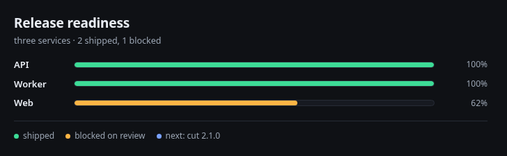

# HTML Render

Ask your Paseo agent for a comparison, a status, a flow or a set of numbers and get a visual card in the timeline instead of a wall of Markdown. The card is a self-contained HTML page: live and sandboxed on web and desktop, a static image or a native report on a phone.



Two MCP tools are injected into every agent created after install: `html_preview` checks a page as a PNG, `html_render` publishes it as a durable card.

## Install

Not on npm yet, so install from a checkout:

```sh
git clone https://github.com/lued/paseo-html-render.git
cd paseo-html-render
npm ci --ignore-scripts
paseo plugin install .
paseo plugin reload html-render
```

Requires Paseo 0.12.0 or newer, Node 22.18 or newer on the daemon host, and a sandbox-capable Chromium. Chromium is found from the system or from the `shared-browser` plugin; set `PASEO_HTML_RENDER_CHROMIUM` to override. Without one, preview and publish fail instead of launching an unsafe browser.

## What it does

- Pages are fluid and theme-aware. Use `--background`, `--card`, `--border`, `--accent`, `--chart-1` … `--chart-6`; live theme changes update the frame without reloading.
- Artifacts are private: `0700` directories, `0600` files, and every read is checked against the requesting agent's workspace.
- The live frame is `sandbox="allow-scripts"` with an opaque origin and never `allow-same-origin`; CSP blocks network, forms, frames and `file://`. Screenshots and native reports never execute HTML.
- Workspace images are inlined up to 2 MiB each; remote assets are never fetched.

## Limits

- A web iframe can still navigate itself, so CSP and click interception do not fully contain `location.assign` or a meta refresh. Arbitrary live HTML is not incapable of navigation.
- Local SVG files are refused; inline SVG markup works.
- Agents that existed before install keep their injected tools. A running adapter reports itself stale and asks for one reconnect.

## Develop

```sh
npm ci --ignore-scripts
npm run typecheck && npm test
npm run verify:e2e
```

MIT. Display rules, layout and T3 differences are in [OVERVIEW.md](OVERVIEW.md), [docs/compatibility.md](docs/compatibility.md) and [docs/verification.md](docs/verification.md). Publishing, and the pre-publish check that proves the packed tarball works, is [docs/release.md](docs/release.md).
