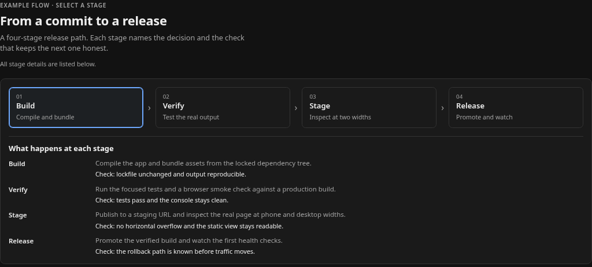
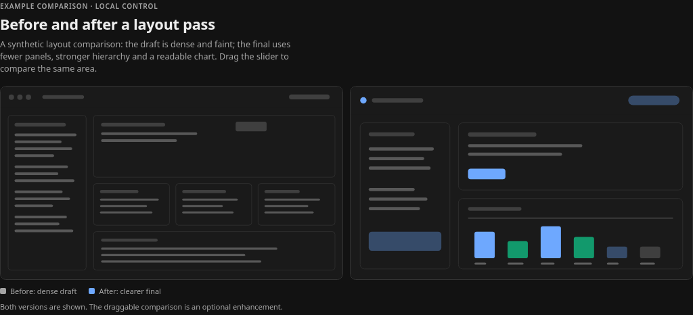
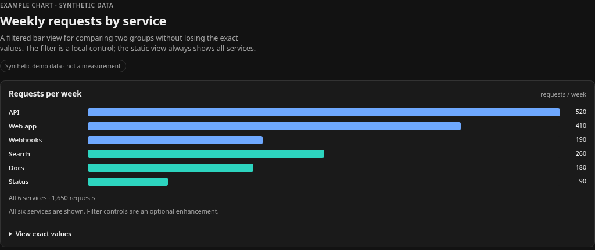

# Motion and local interactivity

A live HTML card can teach something a screenshot cannot: which stage a flow
depends on, how two images differ, or which slice of a chart matters. It should
not make every answer move. Use interaction when the reader gains a clearer
answer, and keep the static page useful on its own.

The examples in [`examples/interactive/`](../examples/interactive/) work under
the plugin's existing security boundary. They use inline CSS, inline SVG, the
DOM and inline JavaScript only: no library, CDN, new dependency or CSP change.

| Example | Local interaction | Static fallback (scripts disabled) |
| --- | --- | --- |
| [Release flow](../examples/interactive/flow.html) | Click or arrow-key through four stages; a short reveal updates the detail panel. | Every stage's explanation and check is already listed below the flow. |
| [Before / after inspector](../examples/interactive/inspector.html) | Move a native range to reveal more of the final layout. | Both labelled images remain side by side. |
| [Filtered chart](../examples/interactive/filter.html) | Filter synthetic services by group and open an exact-value table. | All rows, totals and the table stay visible; filter controls are hidden. |

Static captures use the plugin's own renderer with page JavaScript disabled.
They are previews, not screenshots of the Paseo application:

| Flow | Inspector | Filter |
| --- | --- | --- |
|  |  |  |

The phone-width captures are
[flow-390.png](../examples/interactive/captures/flow-390.png),
[inspector-390.png](../examples/interactive/captures/inspector-390.png) and
[filter-390.png](../examples/interactive/captures/filter-390.png). The
[manifest](../examples/interactive/captures/manifest.json) records the source
hash, renderer, widths and content heights.

## What works

Inside the live web/desktop frame, and in `interactive.html` when opened in a
browser, the page may use:

- inline `<style>`, inline `<script>`, the DOM, inline SVG and `data:` raster
  images;
- theme variables such as `--background`, `--foreground`, `--card`, `--border`,
  `--accent`, `--muted-foreground`, `--radius` and `--chart-1` through
  `--chart-6`;
- native buttons, links, checkboxes, ranges and `<details>` with visible focus;
- local state changes such as selecting a stage, filtering rows, changing a
  comparison position or switching a view;
- short CSS transitions or keyframe reveals that show what changed;
- `prefers-reduced-motion` in CSS and `matchMedia` logic in JavaScript.

The live frame is sandboxed with `allow-scripts` only. It has an opaque origin:
scripts can change their own document, but cannot read the Paseo page, its
storage or the session.

## Static first

`html_preview` returns a PNG with page JavaScript disabled. Native clients show
a static PNG or the native report, never the live iframe. A reader may also open
the published page in a context where scripts fail.

Design the default markup first:

1. Put the answer in ordinary HTML: labels, values, the flow, both images or all
   chart rows. A reader who never runs a script should still understand it.
2. Make controls inert until the enhancement is ready. The examples start
   buttons and the range as `disabled`, hide script-only controls, and only add
   an `html.js` class after the initial content is wired. If a script fails, the
   static explanation remains.
3. Do not use JavaScript to build the only copy of the content. Generate
   optional detail, filtering and animation from markup that already exists.
4. Keep the page one full-width visual where possible. Avoid a pile of nested
   cards or a dashboard made only of decorative boxes.

The examples use a small `html.js` class rather than `noscript` because the same
document must work as a published file, a live frame and a script-disabled
screenshot. The static renderer never adds the class.

## Motion rules

Motion should answer "what changed?" or "what is related?", not decorate the
card.

- Prefer a short reveal, a border change or a filtered row entering. Keep it
  under roughly 200 ms unless the content genuinely needs longer.
- Do not add particle wallpaper, floating cards, bouncing panels, parallax,
  strobing or continuous idle animation.
- Do not run an infinite animation by default. If a continuous demonstration is
  truly necessary, add a visible pause/stop control, start paused or let the
  reader start it, and explain what it shows.
- Avoid timed JavaScript sequences and smooth scrolling. If you use them, check
  `prefers-reduced-motion` before starting.
- Respect reduced motion in both places: a CSS media query for transitions and
  animations, and a JavaScript check for any behavior JavaScript starts.
- The examples also expose an explicit `data-motion="reduce"` state. It mirrors
  the media query for deterministic testing; it is not a substitute for the
  media query.

## Accessibility and layout checklist

- Use native controls (`button`, `input`, `details`) with visible focus. A
  custom `<div>` control needs a role, a tab stop and Enter/Space handling; it is
  usually the wrong choice.
- Give every control an accessible name. Use `aria-pressed` for a toggle,
  `aria-expanded` for a disclosure, `aria-controls` when it targets a region,
  and a polite live region for a result that changes.
- Keep keyboard order logical. The flow example adds Left/Right/Home/End on top
  of native button activation; the inspector uses the range's native keys.
- Do not rely on color alone. Pair state with text, a check mark, a label or a
  value.
- Use theme tokens for contrast, and let the host theme change without rebuilding
  the document.
- Test at phone and desktop widths. Inline SVG and images should scale; grids
  should use `minmax(0, 1fr)` and stack below the narrow breakpoint. There must
  be no horizontal scroll at about 390 px or 1024 px.
- Do not put critical text in an SVG-only label or a canvas. An `aria-label`,
  caption or adjacent HTML sentence is part of the static answer.

## What does not work

The current sandbox and CSP deliberately block more than they allow:

- remote scripts, stylesheets, fonts, images, media, `fetch`, XHR, WebSocket and
  other network calls;
- external libraries such as Three.js, D3 or animation packages loaded from a
  CDN. A browser-loaded library is still a network and security dependency, and
  it fails offline. Vendoring one would need a separate size, license, CSP and
  review proposal; do not treat this guide as permission.
- forms, popups, frames, workers, objects, `base`, `unsafe-eval` and `eval`-like
  code;
- `file://` resources and local SVG files. Inline SVG markup is supported.
- clipboard, downloads, notifications, fullscreen and other browser permissions
  that are not part of the supported surface. Do not promise them.
- Paseo workspace or agent control. A local diagram button cannot start an
  agent, open a workspace, run a command or change the host. The only
  host-reaching actions today are the existing user-activated http(s) link and
  `data:` image open requests; they are not a general host API.
- live behavior on native clients or in the static preview. Those surfaces get
  the PNG or native report, so a page must not claim that a control is usable
  there when it is only a screenshot.

One limitation remains in the live iframe: a page can still navigate itself, for
example by assigning `location` or using a zero-delay meta refresh. CSP and link
interception do not fully contain that, so only publish HTML you trust.

An inline SVG illustration is fine. An `` is
also allowed by the image policy, but inline SVG is easier to theme and inspect.
Workspace raster images are inlined by the publisher; remote image URLs stay
blocked.

## Natural prompts

Ask for the answer and the fallback, not just "make it interactive":

> Show the path from commit to release as four stages. Each stage should have a
> one-line explanation and a check. Let me click or arrow through stages for a
> little more detail, but list every stage's detail in the static page too. Use
> inline HTML/CSS/JS only and respect reduced motion.

> Compare these two layouts with a before/after slider. Keep both versions
> labelled and side by side when scripts are disabled. Use a native range, not a
> custom drag handler.

> Chart the weekly request counts by service with a filter for Platform and
> Content. Show the exact values in a table, label synthetic demo data clearly,
> and do not fetch anything. The static view should show all services.

> Add a short state transition when I choose a filter, but no looping animation.
> If motion is reduced, switch instantly. Keep the controls keyboard accessible
> and the page free of horizontal overflow at phone and desktop widths.

A useful default is: one visual that carries the answer, one local control only
if it adds understanding, readable content without scripts, and no claim that
the card can drive Paseo.

## Verification

The example test renders the exact sources through the existing document
builder and CSP, then runs them in real sandboxed `allow-scripts` frames at
390 px and 1024 px:

```sh
node --test tests/interactivity-examples.test.ts
npm run typecheck
```

It checks at least one live state change, click and keyboard operation, the
script-disabled fallback, reduced-motion CSS and script behavior, phone/desktop
reflow without horizontal overflow, and that no external resource is requested.
The reduced-motion browser test also emulates Chromium's
`prefers-reduced-motion` media feature, so `matchMedia` and the example's
`data-motion` hook are verified from the browser preference rather than a manual
state write.

The live frames carry the same CSP and never use `allow-same-origin`. The static
renders use `server/renderer.ts` with `Emulation.setScriptExecutionDisabled`.

Regenerate the reviewed captures with:

```sh
node scripts/capture-interactivity.mjs
```

The full suite runs serially at integration time, after both presentation lanes
are combined:

```sh
npm test
```

## Related files

- [Policy guidance](../shared/policy.ts) for when a visual is worth making.
- [Verification notes](https://github.com/lued/paseo-html-render/blob/main/docs/verification.md) for the release-gate context and the
  remaining self-navigation limitation of the live iframe.
- [Compatibility notes](compatibility.md) for web/desktop versus native
  differences.
