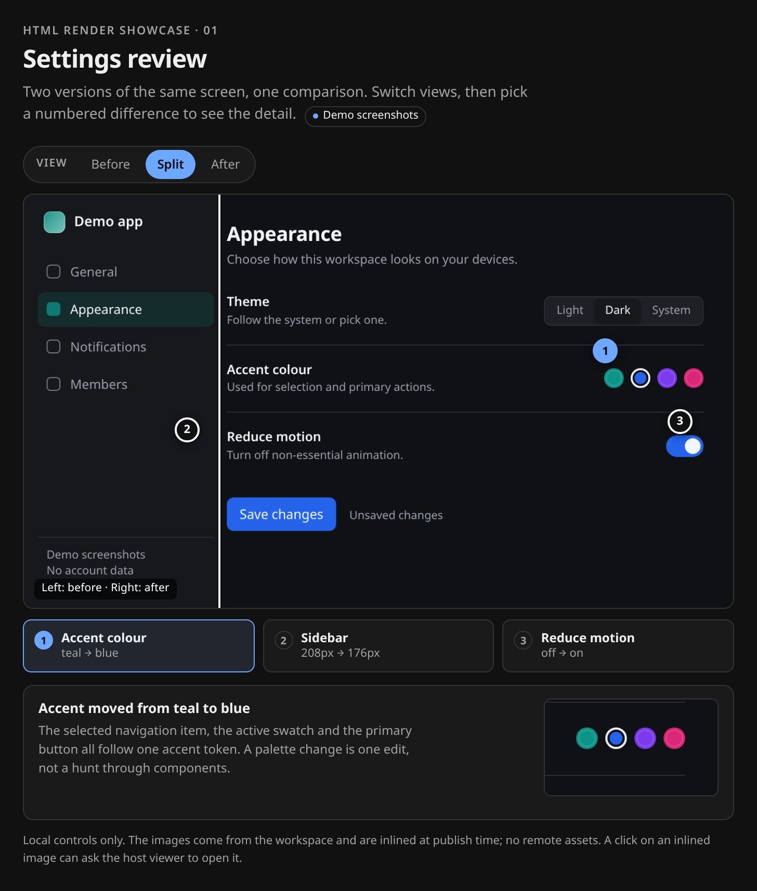
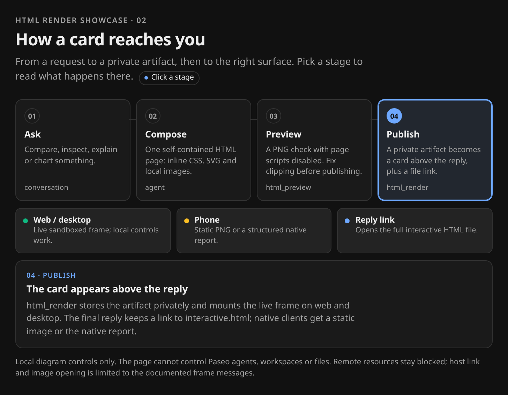
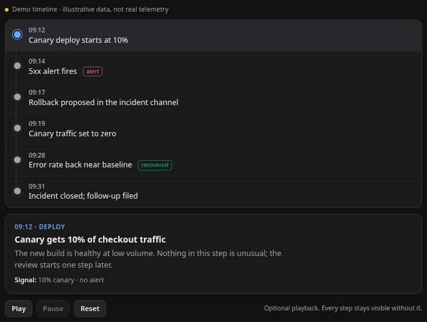

# Showcase

Three real examples of what HTML Render is for. Every still and recording below is
captured from the checked-in source page, not a mockup. The pages are standalone
demo files: on web/desktop the same page runs as a live sandboxed card in Paseo,
and the captures are **not** a fabricated Paseo window. Clone the repo and open
any source page directly in a browser to try its controls; no server or build step
is needed.

- [Inspect an image](#1-inspect-an-image)
- [Explain a flow](#2-explain-a-flow)
- [Replay a timeline](#3-replay-a-timeline)
- [What appears in Paseo](#what-appears-in-paseo)
- [Prompts to reuse](#prompts-to-reuse)
- [Interaction and limits](#interaction-and-limits)
- [Capture notes](#capture-notes)

## 1. Inspect an image

> Compare these two screenshots of the settings screen. Show me what changed and
> let me inspect each difference.

**What to notice**

- Before / Split / After switch the view, and the three numbered pins select a difference. In Split the two states meet at the sidebar edge; choose After to see the narrower sidebar in place. All of it is CSS-only, so it still works when scripts are disabled.
- The detail panel uses a real crop of the after screenshot. The sidebar card notes the exact width change instead of making the reader eyeball it.
- The images live beside the source. At publish time the plugin inlines them from the workspace; the page has no remote image URLs.

[Source page](../examples/showcase/image-inspection.html) · [Screenshot sources and crops](../examples/showcase/assets/)

## 2. Explain a flow

> Show me how a visual gets from my request into the timeline, including what my
> phone sees.

**What to notice**

- The diagram carries the explanation: request → compose → preview → publish, then the three surfaces (live web/desktop, phone still, reply link).
- Clicking a stage updates the detail panel below. That is a local document control, not a Paseo workspace action.
- The page is useful before interaction: the full flow, surface labels and the default Publish detail are all in the static markup.

[Source page](../examples/showcase/render-pipeline.html) · [Display details](compatibility.md)

## 3. Replay a timeline

> Replay this deploy failure as a timeline I can step through, and show what
> happened at each point.

**What to notice**

- The six events stay visible. Playback only moves the highlight and the detail panel; it never hides the story behind an animation.
- Play / Pause / Reset appear only when scripts run. Without scripts, every event is still readable and selectable, and the page says so.
- Reduced-motion users get the final step instead of an animated walk. The page also uses `prefers-reduced-motion` to remove transitions.
- **The incident is fictional.** The page labels it “Demo timeline · illustrative data, not real telemetry”.

[Source page](../examples/showcase/incident-timeline.html) · [Static fallback capture](images/showcase/incident-timeline-static.png)

The GIF is a recording of the source page at six steps. It is not a live iframe or
a product video. The source page is the interactive artifact.

## What appears in Paseo

| Surface | What the reader gets |
| --- | --- |
| Web / desktop | A live `sandbox="allow-scripts"` frame above the reply. Local controls and inline script run; the frame has an opaque origin. |
| Phone | A static PNG or a structured native report. Page JavaScript does not run. |
| Reply | An `Open interactive report` link to the CSP-protected `interactive.html` file. |

`html_preview` shows a PNG with page scripts disabled. That is deliberate: the
static preview, the phone view and the screenshot fallback should not depend on
JavaScript. Remote resources remain blocked on every surface; workspace raster
images are inlined (2 MiB each, 8 MiB total document limit).

The embedded page cannot control Paseo agents, workspaces or files. It can ask the
host to open an absolute `http(s)` link or a data-URI image through the documented
frame messages. A live page can still navigate itself; that limitation is in
[compatibility](compatibility.md#security-differences-deliberately-stricter-than-t3).

## Prompts to reuse

Good prompts name the question, the comparison or the sequence, and the decision
the reader should make. They do not prescribe a card grid.

- “Compare these two screenshots of the checkout page and mark the three visual differences that affect conversion.”
- “Map how a request moves through these four services. Let me click a step to see its failure mode.”
- “Show the last six steps of this incident in order, with the signal that changed at each step.”
- “Chart these tool results over time and label the source. If a number is missing, leave it out instead of estimating.”
- “Explain this architecture to a new engineer: one diagram, clickable components, and a short note on what each one owns.”

## Interaction and limits

The examples follow the same rules as the plugin's long-form guidance:

- Static content first. Every fact is visible without scripts; interaction adds a view, a detail or a replay.
- Keyboard focus is visible. Radio labels and buttons are native controls, not divs with click handlers.
- Motion is optional and never continuous. There is a pause/stop path, and reduced motion is honoured.
- No remote assets, no `file://`, no host API calls in the example code, no fake data presented as real.

The full interaction guidance lives in [the interaction guide](interactivity.md).
Platform differences and the trust model are in [compatibility](compatibility.md).

## Capture notes

- Captured from the sources in [`examples/showcase/`](../examples/showcase/) with the local Chromium used by the plugin's renderer. No browser download, no global install, no external media.
- Stills are 2x captures at a 728 px column. The GIF is a 1x, six-frame recording of the timeline page.
- `incident-timeline-static.png` was captured with script execution disabled, matching the plugin's static screenshot path. The other stills show the interactive source.
- The capture script is [`docs/images/showcase/capture.mjs`](images/showcase/capture.mjs). It uses only Node built-ins and the repository's existing Chromium discovery.
- **No full Paseo chrome capture.** Producing one for this showcase would require creating a live agent and publishing a card; reusing an existing verification screenshot would expose unrelated workspace names. The standalone captures are labelled as such; host behaviour is documented, not staged.
- Total showcase binary assets are kept below 2 MiB. Exact file list, sizes and the check command are in [`CAPTURES.md`](images/showcase/CAPTURES.md).

For the files behind the screenshots and the GIF, see [`CAPTURES.md`](images/showcase/CAPTURES.md).
